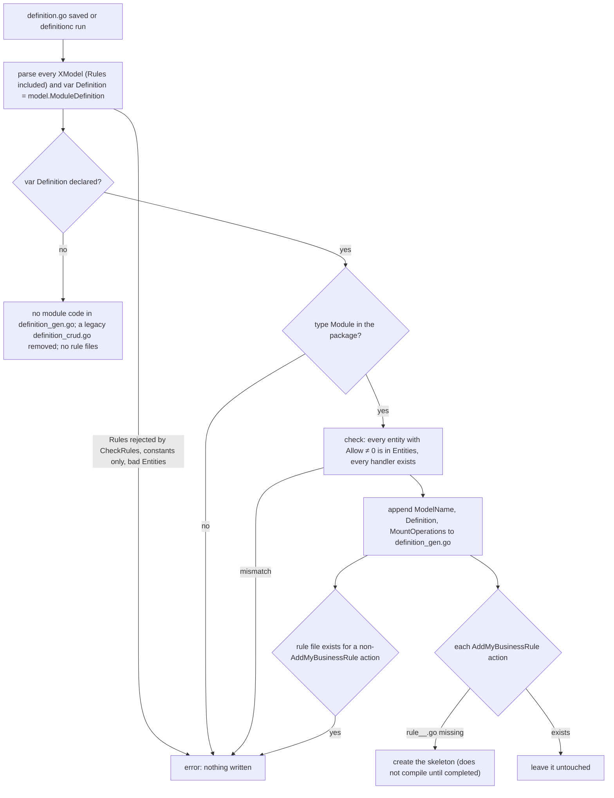

← [Plan](PLAN.md) | Next → [Stage 2](PLAN_STAGE_2_PARSING.md)

# Stage 1 — tests first (red)

Diagram first: write `docs/diagrams/MODULE_GENERATION.md` now (walkthrough filled in stage 5) with this `flowchart TD`, and make the tests walk every branch:



## Helper (`tests/helpers_test.go`, package `tests`)

```go
// generate writes a module in a temp dir (go.mod requiring crud, the given definition.go, an optional extra file) and runs definitionc on it.
func generate(t *testing.T, definition string, extra ...file) (dir string, err error) {
	t.Helper()
	dir = t.TempDir()
	write(t, dir, "go.mod", "module example.com/mod\n\ngo 1.26.8\n\nrequire webtyp.com/crud v0.0.7\n")
	write(t, dir, "definition.go", definition)
	for _, f := range extra {
		write(t, dir, f.name, f.body)
	}
	gen := definitionc.New()
	gen.SetSkipTidy(true)
	gen.SetRootDir(dir)
	return dir, gen.Run()
}

type file struct{ name, body string }

func write(t *testing.T, dir, name, body string) {
	t.Helper()
	if err := os.WriteFile(filepath.Join(dir, name), []byte(body), 0o644); err != nil {
		t.Fatal(err)
	}
}

func read(t *testing.T, dir, name string) string {
	t.Helper()
	b, err := os.ReadFile(filepath.Join(dir, name))
	if err != nil {
		t.Fatal(err)
	}
	return string(b)
}

// squash collapses every run of spaces and tabs to one space, so gofmt's alignment never decides a test.
func squash(s string) string { return strings.Join(strings.Fields(s), " ") }

func exists(dir, name string) bool {
	_, err := os.Stat(filepath.Join(dir, name))
	return err == nil
}

const moduleType = "package mod\n\ntype Module struct{}\n" // the hand-written type the generated methods hang on
```

Reusable definition sources (constants in the same file):

```go
const patientDef = `package mod

import "webtyp.com/model"

var Definition = model.ModuleDefinition{Name: "patient_directory", Entities: []model.Definition{PatientModel}}

var PatientModel = model.Definition{
	Name:  "patient",
	Allow: model.Create | model.Read | model.Update,
	Rules: model.Rules{Create: model.AddMyBusinessRule, Read: model.AddMyBusinessRule, Update: model.AddMyBusinessRule},
	Fields: model.Fields{
		{Name: "id", Type: model.Text(), DB: &model.FieldDB{PK: true}},
		{Name: "name", Type: model.Text(), Item: model.ItemLabel},
	},
}
`
```

`moduleType` goes in a file named `module.go` (`file{"module.go", moduleType}`), because the generator reads the package directory.

## `tests/rules_parse_test.go`

| Test | setup → call → expected |
|---|---|
| `TestRules_UndeclaredActionIsAnError` | `Allow: Create\|Read`, `Rules: model.Rules{Create: model.HaveNoBusinessRule}` → `err` contains `must declare its rule` and `patient` |
| `TestRules_OrphanRuleIsAnError` | `Allow: Create`, `Rules{Create: HaveNoBusinessRule, Delete: AddMyBusinessRule}` → `err` contains `does not offer` |
| `TestRules_ConstantsOnly` | `Rules: someVar` (an identifier) → `err` contains `model.Rules{` and `PatientModel` |
| `TestRules_UnknownKeyIsAnError` | `Rules: model.Rules{Archive: model.AddMyBusinessRule}` → `err` contains `Archive` |
| `TestRules_ModeMustBeAConstant` | `Rules: model.Rules{Create: mode}` → `err` contains `model.AddMyBusinessRule or model.HaveNoBusinessRule` |
| `TestRules_TableWithoutKeyReadMustBeDomain` | no field has `DB`, `Allow: model.Read`, `Rules{Read: model.HaveNoBusinessRule}` → `err` contains `AddMyBusinessRule` |
| `TestRules_WireReadOnlyThroughItsRule` | `Wire: true, Allow: model.Read, Rules{Read: model.AddMyBusinessRule}` → no error; `Wire: true, Allow: model.Create` → error (from `CheckRules`) |
| `TestModuleDefinition_NotMistakenForAnEntity` | `patientDef` plus `module.go` → no error and `definition_gen.go` has no `type Definition struct` (the variable `Definition` is the module, never an entity) |

## `tests/module_gen_test.go`

All use `generate(t, <source>, file{"module.go", moduleType})` unless stated; `got := read(t, dir, "definition_gen.go")`; whitespace is not part of the contract (gofmt aligns keys), so every `contains` is checked on `squash(got)`; every generated file must also parse with `go/parser` (helper `mustParse(t, got)`).

| Test | setup → call → expected |
|---|---|
| `TestModule_MountsAStoredEntity` | `patientDef` → `squash(got)` contains, verbatim: `const ModelName = "patient_directory"`, `func (m *Module) ModelName() string { return ModelName }`, `func (m *Module) Definition() model.ModuleDefinition { return Definition }`, `func (m *Module) MountOperations(reg crud.Registry) {`, `reg.AddStoredEntity(crud.StoredEntity{`, `Model: &Patient{},`, `NewList: func() model.ModelSlice { return &PatientList{} },`, `Store: m.StorePatient(),`, `Rules: PatientModel.Rules,`, `return rec.(*Patient).Create(a, tx, m)`, `return next.(*Patient).Update(a, tx, old.(*Patient), fields, m)`, `return (&Patient{}).Search(a, text, m)`; and does **not** contain `Delete:` |
| `TestModule_StandardActionsHaveNoHook` | `Rules: Create: HaveNoBusinessRule, Read: HaveNoBusinessRule, Update: HaveNoBusinessRule` → `got` contains `reg.AddStoredEntity(crud.StoredEntity{` and `Rules: PatientModel.Rules,` and none of `Create: func`, `Update: func`, `Search: func`, `webtyp.com/storage`; no `rule_*.go` file exists |
| `TestModule_MFAIsCarriedToTheStoredEntity` | `Allow: …\|model.Update`, `MFA: model.Update` → `squash(got)` contains `MFA: PatientModel.MFA,`; with no `MFA` field declared it still contains that line (the zero value requires nothing) |
| `TestModule_StorePerEntity` | `Entities: {PatientModel, VisitModel}` → contains `Store: m.StorePatient(),` and `Store: m.StoreVisit(),` |
| `TestModule_DeleteHook` | `Allow: …\|model.Delete`, `Delete: AddMyBusinessRule` → `got` contains `return rec.(*Patient).Delete(a, tx, m)` |
| `TestModule_ReadOnlyModelUsesRegistryRead` | `HealthModel` with no `DB` field, `Allow: model.Read`, `Rules{Read: AddMyBusinessRule}`, listed in `Entities` → `got` contains `reg.AddReadOnlyEntity(&Health{}, nil, func(a crud.CurrentUser, args crud.ReadArgs, _ model.Model) (model.ModelSlice, error) {` and `return (&Health{}).Read(a, args, m)`; no `crud.StoredEntity` for it |
| `TestModule_WireModelUsesRegistryRead` | `Wire: true` variant of the above → same output |
| `TestModule_TwoEntities` | `Entities: {PatientModel, VisitModel}` → one `reg.AddStoredEntity` per entity, in the order of `Entities` |
| `TestModule_InternalEntityIsListedButNotMounted` | a third entity with `Allow` absent, listed in `Entities` → no `reg.AddStoredEntity` for it |
| `TestModule_NoDefinitionNoModuleCode` | a `definition.go` with entities and no `var Definition`; a legacy `definition_crud.go` placed beforehand → after `Run` it does not exist, `definition_gen.go` has no `MountOperations`, and no rule file was created |
| `TestModule_EntityNotListedIsAnError` | `Allow ≠ 0` entity missing from `Entities` → `err` contains `PatientModel` and `Entities` |
| `TestModule_UnknownHandlerIsAnError` | `Entities: {GhostModel}` → `err` contains `GhostModel` |
| `TestModule_HandlerMustEndInModel` | `Entities: {Patient}` → `err` contains `<Name>Model` wording (`must be written XModel`) |
| `TestModule_ModuleTypeIsRequired` | no `module.go` → `err` contains `type Module` and the package directory |
| `TestModule_NameRequired` | `Name: ""` → `err` contains `Name` |
| `TestModule_Regenerates` | run twice → `definition_gen.go` identical both times |

## `tests/rule_skeleton_test.go`

| Test | setup → call → expected |
|---|---|
| `TestSkeleton_CreatedForEachDomainAction` | `patientDef` → exist: `rule_patient_create.go`, `rule_patient_update.go`, `rule_patient_search.go`; absent: `rule_patient_delete.go` |
| `TestSkeleton_NotCreatedForStandard` | all HaveNoBusinessRule → no `rule_*.go` |
| `TestSkeleton_ExactShapes` | `Allow` all four with `AddMyBusinessRule` → each file contains its signature from the table in `PLAN.md` verbatim (`func (p *Patient) Create(a crud.CurrentUser, tx crud.Tx, m *Module) (crud.RuleAnswer, error) {`, `func (next *Patient) Update(a crud.CurrentUser, tx crud.Tx, old *Patient, fields []string, m *Module) (crud.RuleAnswer, error) {`, `func (p *Patient) Delete(a crud.CurrentUser, tx crud.Tx, m *Module) (crud.RuleAnswer, error) {`, `func (p *Patient) Search(a crud.CurrentUser, text string, m *Module) ([]storage.Condition, error) {`, and for the read-only model `func (p *Health) Read(a crud.CurrentUser, args crud.ReadArgs, m *Module) (model.ModelSlice, error) {`) and the line `// COMPLETA TU REGLA DE NEGOCIO AQUÍ` |
| `TestSkeleton_DoesNotCompileUntilCompleted` | parse `rule_patient_create.go` with `go/parser` → ok; the function body declares `var decision crud.RuleAnswer` and `var rejected error` and contains **no** `return` statement (so the Go compiler reports `declared and not used` and `missing return`) |
| `TestSkeleton_NeverOverwritesACompletedRule` | after the first run replace the file with `package mod // done`; run again → the file is byte-identical |
| `TestSkeleton_DeletedFileIsRecreated` | delete `rule_patient_create.go`; run → exists again with the marker |
| `TestSkeleton_OrphanRuleFileIsAnError` | `Delete` not allowed, file `rule_patient_delete.go` present → `err` contains `rule_patient_delete.go` and `Rules.Delete` |
| `TestSkeleton_UsesTheModelName` | entity with `Name: "visit_note"` → file `rule_visit_note_create.go` (the entity's snake-case `Name`, not the Go struct name) |

Run `gotest`: it must fail (symbols and behaviour missing). Commit: `test: module mount and rule skeletons (red)`.
