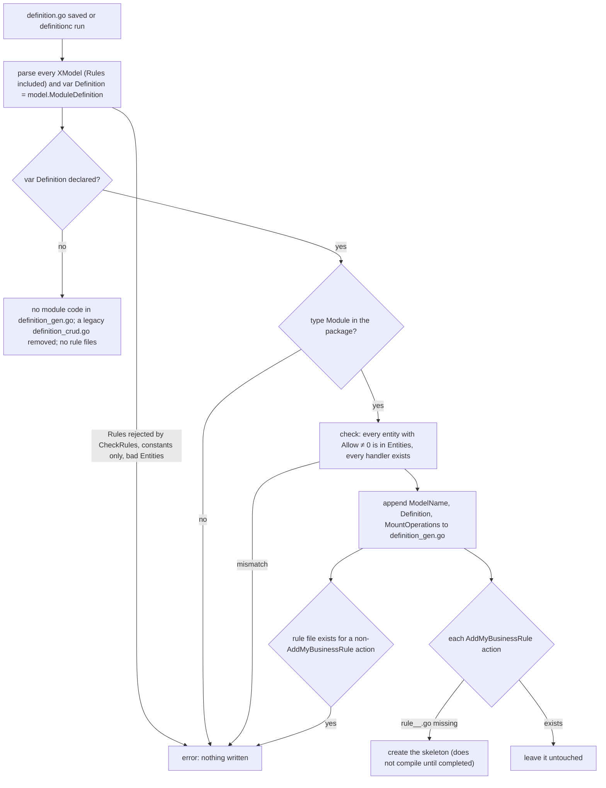

# Module generation — what `definitionc` writes for a module

> When a developer saves `definition.go`, `definitionc` writes the module's operations into `definition_gen.go`
> and creates one rule file per business rule the developer declared. The developer completes those rule files;
> `definitionc` never overwrites them.

## Flow

## Walkthrough

1. **definition.go saved or definitionc run.** The generator reads the one file of the package that declares models and the module.
2. **Parse every XModel and var Definition.** Each `model.Definition` is read through the AST, with its `Allow` and `Rules`; `var Definition` lists the entities of the module. A `Rules` value that is not a constant, a rule that does not match its action, or a `Wire` model that is not read-only stops the run here: nothing is written.
3. **var Definition declared?** A package with no module declaration gets no module code. Its legacy `definition_crud.go` is removed, and no rule file is created.
4. **type Module in the package?** The generated methods hang on the hand-written `Module`. Without it the run stops and names the package directory.
5. **Check the module.** Every entity that allows an action must be listed in `Entities`, and every listed handler must be declared. A mismatch stops the run before anything is written.
6. **Append ModelName, Definition and MountOperations.** The module code joins `definition_gen.go`, the one generated file of the package.
7. **Each AddMyBusinessRule action.** For every action declared with a business rule, the generator looks for its rule file.
8. **rule_<entity>_<verb>.go missing.** The skeleton is written. It declares its outputs and returns nothing, so the module does not compile until the developer completes it.
9. **Rule file already exists.** The file belongs to the developer and is left untouched, byte for byte.
10. **Rule file for an action that is not AddMyBusinessRule.** A rule file for an action the entity does not declare with a business rule is an error: the file or the declaration must go.
