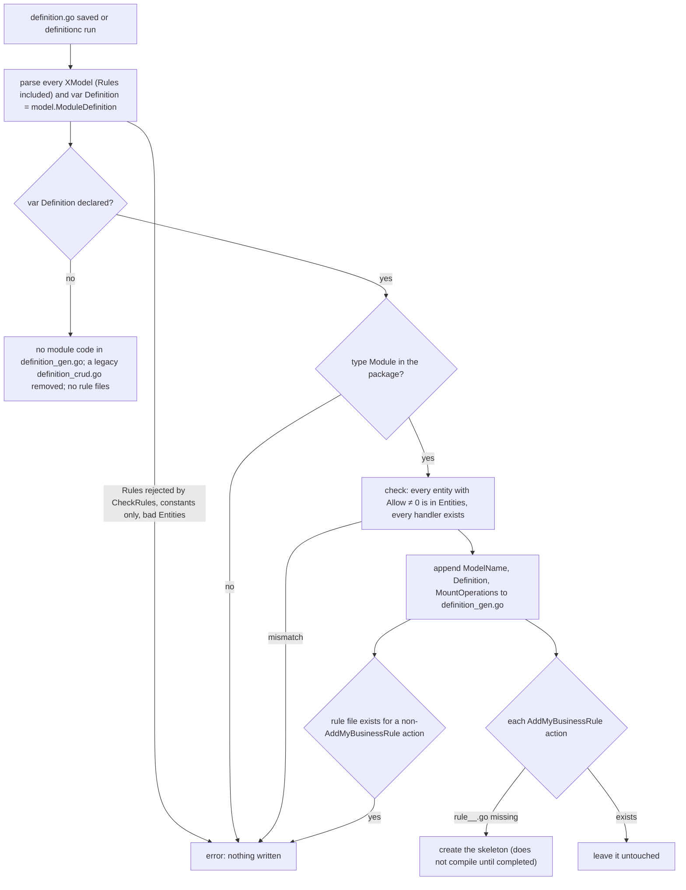

# Module generation — what `definitionc` writes for a module

> When a developer saves `definition.go`, `definitionc` writes the module's operations into `definition_gen.go`
> and creates one rule file per business rule the developer declared. The developer completes those rule files;
> `definitionc` never overwrites them.

## Flow

